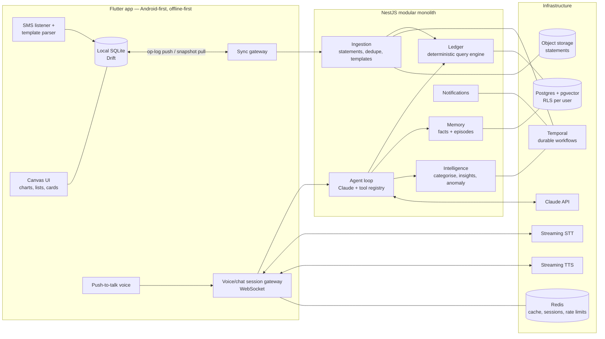

# Atlas — v0.1 Architecture

**Status:** Proposed · **Last updated:** 2026-08-06 · **Owner:** Founder + Claude (technical co-founder)

---

## 1. What we are building (and not building)

**v0.1 wedge:** A read-only conversational CFO for Nigeria. The user talks to Atlas
(voice or text); Atlas knows every transaction across their accounts, remembers
everything important about their financial life, answers any question truthfully in
under ~2 seconds, and proactively surfaces things worth knowing before being asked.

**Explicitly out of scope for v0.1:**

- Money movement of any kind (transfers, payments, investing) — v2+, after trust is earned.
- Bank aggregator APIs (Mono/Okra) — deliberately skipped; see [ADR-001](adr/001-nigeria-first-aggregatorless-ingestion.md).
- iOS client — deferred to after M3, see [ADR-006](adr/006-android-first.md). iOS cannot read SMS
  (no API exists), so it can be a full Atlas _client_ but never an _ingestion node_;
  Android is ~80%+ of the Nigerian market and gives instant transaction history on first run.
- Full-duplex barge-in voice — v0.2 polish; v0.1 ships push-to-talk (§8).
- Financial _advice_ (product gives facts, analysis, and observations about the user's own data — never investment recommendations; regulatory line we do not cross in v1).

## 2. Product invariants (non-negotiable, enforced in code)

| #   | Invariant                                                                                              | Enforcement                                                                                                                     |
| --- | ------------------------------------------------------------------------------------------------------ | ------------------------------------------------------------------------------------------------------------------------------- |
| I1  | The database is the source of truth. The LLM is never.                                                 | Every number spoken traces to a tool result (§7.4 grounding gate).                                                              |
| I2  | Financial math is deterministic.                                                                       | All money math in the ledger module; LLM never computes sums.                                                                   |
| I3  | Money is integers in minor units (kobo) + ISO currency code. Never floats.                             | `Money` value object in shared kernel; lint rule bans `number` arithmetic on amounts.                                           |
| I4  | Raw SMS/email content stays on-device by default.                                                      | Server receives structured transactions; raw text uploaded only with explicit per-event consent (parse-failure flywheel, §6.1). |
| I5  | Memory is append-only and versioned. Corrections create new versions; nothing is silently overwritten. | Event-sourced facts store (§7.5).                                                                                               |
| I6  | Every user-visible claim is explainable.                                                               | Insights and answers carry provenance references to underlying transactions.                                                    |

## 3. System overview

One deployable backend artifact. One database. Module boundaries are enforced in
code (§5) so that any module can be extracted to a service later without a rewrite —
but none is, until a team boundary forces it.

## 4. Bounded contexts (DDD)

| Context         | Owns                                                             | Key rule                                                                                        |
| --------------- | ---------------------------------------------------------------- | ----------------------------------------------------------------------------------------------- |
| `identity`      | Users, devices, auth (passkeys + OTP), consent records           | Every consent is a stored, timestamped record (NDPR).                                           |
| `ledger`        | Accounts, transactions, balances, categories, merchants          | The deterministic core. Only module allowed to do money math. All reads via typed query engine. |
| `ingestion`     | SMS parse templates, statement imports, dedup/reconciliation     | Never writes to ledger directly — emits `TransactionObserved` events; ledger owns admission.    |
| `intelligence`  | Categorization, recurring-payment detection, anomalies, insights | Produces `Insight` records with provenance; never mutates ledger facts.                         |
| `memory`        | Structured facts, episodic summaries, embeddings                 | Append-only, versioned (I5).                                                                    |
| `conversation`  | Sessions, turns, agent loop, tool registry, grounding gate       | The only module that talks to Claude.                                                           |
| `voice`         | STT/TTS adapters, audio session state                            | Vendor-agnostic ports; providers are adapters.                                                  |
| `notifications` | Push delivery, digest scheduling                                 | Delivery only; content comes from intelligence.                                                 |
| `shared-kernel` | `Money`, `Result`, ids (ULID), clock, event bus contracts        | No business logic.                                                                              |

Inter-module communication: in-process domain events through a typed event bus,
persisted via a transactional outbox — the same events become the service-extraction
seam later.

## 5. Data architecture

### 5.1 Transaction identity & deduplication (the hard problem)

Three sources describe the same real-world transaction: an SMS alert, a statement
line, and possibly the user's own words. Dedupe strategy:

1. Every observation becomes an immutable `transaction_observation`
   (source, account, amount, direction, occurred_at, balance_after?, raw_ref).
2. A reconciliation pass (Temporal workflow) matches observations into one canonical
   `transaction` using: same account + amount + direction + time window (±36h for
   statement↔SMS skew), with **balance_after as the anchor** when present — Nigerian
   bank SMS alerts almost always include available balance, which lets us verify the
   ledger arithmetic and detect _missed_ transactions (balance discontinuity ⇒ gap
   insight: "I may be missing a transaction around Aug 3").
3. Canonical transaction keeps links to all its observations (provenance, I6).

### 5.2 Money & currency

- `amount_minor BIGINT` + `currency CHAR(3)`. NGN and USD as first-class from day 1
  (domiciliary accounts are common); FX conversion only ever for _display aggregation_,
  clearly labeled, using a stored daily rate with its timestamp.

### 5.3 Postgres posture

- Single Postgres with `pgvector`. Row-level security keyed on `user_id` as tenant
  isolation defense-in-depth (the app layer also scopes every query).
- Partitioning `transactions` by month is deferred until >~50M rows; schema is
  designed so it can be added without migration pain (composite PK includes date).

## 6. Ingestion pipelines

### 6.1 SMS/email alerts (primary feed, on-device)

- Android SMS listener filtered by known bank sender IDs.
- Parsing is **deterministic templates** (per bank, per message shape), versioned and
  delivered **as data from the backend** — new bank formats ship without an app release.
- **Template flywheel (AI-native):** when a message from a known bank sender fails to
  parse, the app asks one-time consent to upload the redacted raw text → a backend
  workflow uses Claude to synthesize a candidate template → template validated
  against held-out samples → published to the template registry → all users benefit.
  The LLM writes the parser; the parser stays deterministic in production.
- Email alerts: v0.1 via a per-user forwarding address (`u_x@in.atlas.app`) — no OAuth
  scopes, no IMAP polling; same template pipeline.

### 6.2 Voice/manual entry

`record_transaction` tool → ledger write with `source = user_stated`. Also the
correction channel: "that 15k wasn't fuel, it was a gift" → recategorization event +
a memory that fuel-vs-gift confusion happened (feeds categorizer).

### 6.3 Statement upload (backfill)

PDF/CSV → object storage → Temporal workflow: deterministic parser per known bank
layout; Claude-assisted extraction as fallback **with a hard validation gate**
(row totals must reconcile against statement's own opening/closing balance or the
import is rejected, never silently partial) → observations → reconciliation (§5.1).

## 7. AI architecture

### 7.1 Agent loop

One conversation agent (Claude) with a typed tool registry. Tools are the _only_
way the model touches data. The registry is MCP-shaped (name, JSON-schema, handler)
so exposing genuine MCP servers later is a transport change, not a redesign.

### 7.2 Core tools (v0.1)

`query_ledger` (typed query plan: filters, group-by, time range — compiled to SQL by
the ledger module), `get_balances`, `record_transaction`, `correct_transaction`,
`remember_fact`, `recall` (hybrid structured + vector), `list_insights`,
`render_canvas` (push a chart/list spec to the client, rendered from raw query
results — numbers bypass the LLM entirely), `ask_clarification`.

### 7.3 Model routing

Claude (frontier) for conversation turns. Small/fast model (Haiku) for high-volume
background classification (categorization candidates, template synthesis drafts).
Cost budget is a tracked SLO per DAU from day 1 (§11).

### 7.4 Grounding gate (I1)

- Prompt contract: every numeric claim must come from tool results present in the turn.
- v0.1 enforcement: post-generation validator extracts monetary/numeric claims from
  the response and checks them against the turn's tool-result set; on mismatch the
  turn is regenerated once, then degraded to canvas-only answer ("here's the data")
  rather than ever speaking an unverified number.
- The canvas always renders from raw query results, so even a worst-case text error
  is contradicted on-screen by ground truth.

### 7.5 Memory

- **Structured facts:** subject/predicate/value with confidence, provenance,
  effective-from/to, superseded-by — append-only versions (I5). Examples: salary
  amount & payday, dependents, goals, recurring obligations.
- **Episodic:** per-session summaries embedded in pgvector for semantic recall.
- **Retrieval:** entity-keyed structured lookup first, vector search second; both
  injected as tool results (so memory obeys the grounding gate too).
- **Learning from correction:** a correction writes a new fact version _and_ a
  feedback memory that biases future behavior (e.g., categorizer priors per user).

### 7.6 Proactivity

Temporal schedules per user: weekly digest, anomaly detection, recurring-payment
detection, pre-payday low-balance warning, goal progress. Output is a persisted
`Insight` (with provenance) → push notification → tapping opens a conversation
seeded with that insight's context.

## 8. Voice pipeline (staged deliberately)

| Stage | Interaction                                                                           | Latency target        |
| ----- | ------------------------------------------------------------------------------------- | --------------------- |
| v0.1  | Push-to-talk: hold → streaming STT → agent → streaming text on canvas + streaming TTS | < 1.5s to first audio |
| v0.2  | Hands-free with VAD + barge-in (client cancels TTS, aborts LLM stream)                | < 1.2s                |

- Server-side orchestration over one WebSocket session (audio frames up, text/audio/canvas
  events down). STT/TTS behind ports — evaluate Deepgram vs **Spitch** (Nigerian STT,
  likely better on Nigerian accents/Pidgin) with a recorded eval set before committing.
- Text chat is always available and shares the entire pipeline minus STT/TTS —
  voice is a transport, not a separate product.

## 9. Offline-first sync

- Client SQLite (Drift) is the read model on device; app is fully functional offline
  (SMS keeps parsing, questions over local data can degrade gracefully).
- Sync: client pushes an operation log (client-generated ULIDs, idempotent), pulls
  server snapshots by cursor. Server is authoritative for derived data
  (categorization, reconciliation, insights); client is authoritative for raw
  observations it produced. Field-level last-write-wins with server tiebreak — full
  CRDTs are not justified for this data shape.

## 10. Security & privacy (NDPR)

- Passkey-first auth + device binding; OTP fallback.
- Postgres RLS per user; field-level encryption (AES-GCM, per-user data keys under a
  KMS root) for account numbers and any raw text.
- Raw SMS/email never leaves the device without explicit per-event consent (I4).
- Right-to-erasure: a Temporal workflow that provably deletes across Postgres, Redis,
  object storage, and vendor logs — built in v0.1, because retrofitting deletion is misery.
- All consents are records with timestamps and scope (NDPR audit posture).

## 11. Observability

OpenTelemetry from day 1: traces across gateway → agent → tools → DB; per-turn
metrics: time-to-first-token, time-to-first-audio, tool latency, grounding-gate
failures, SMS parse success rate per bank/template, LLM cost per user-day.
The parse success rate and cost/DAU are _product_ metrics, not just ops metrics.

## 12. Deployment (solo-founder v0.1 → 10M path)

- v0.1: one region. Backend on Fly.io or Railway (2 instances), managed Postgres
  (Neon/Crunchy), managed Redis, Cloudflare R2 for objects, Temporal self-hosted
  single-node (Docker) → migrate to Temporal Cloud when workflows matter more than $.
- Scale path (no rewrite): monolith scales horizontally (stateless; sessions in
  Redis); Postgres → read replicas → partition transactions → shard by user_id;
  event outbox already provides the seam to extract `ingestion` or `intelligence`
  workers if ever needed.

## 13. Top risks

| #   | Risk                                                                         | Mitigation                                                                                                                                 |
| --- | ---------------------------------------------------------------------------- | ------------------------------------------------------------------------------------------------------------------------------------------ |
| R1  | **Banks drift away from SMS alerts** (cost-cutting, WhatsApp/push migration) | Email-forwarding channel is the hedge; statement backfill covers gaps; balance-anchor detects missing data instead of silently lying.      |
| R2  | **SMS template fragility** at scale of bank×format variations                | Templates-as-data + LLM flywheel (§6.1); parse-rate telemetry per bank is a first-class dashboard.                                         |
| R3  | **STT quality on Nigerian accents/Pidgin** kills the voice promise           | Build a 200-utterance eval set week 1; Spitch vs Deepgram bake-off; text input is always first-class.                                      |
| R4  | **LLM + TTS unit cost vs Nigerian willingness-to-pay**                       | Cost/DAU as SLO; Haiku routing for background work; canvas-first answers shorten TTS output; prompt caching.                               |
| R5  | **Hallucinated numbers destroy trust once**                                  | Grounding gate + canvas ground truth (§7.4); degraded-answer path never speaks unverified figures.                                         |
| R6  | **Dedupe errors** double-count or drop transactions                          | Balance-anchored reconciliation; observations immutable so every merge is reversible; "possible gap" insights instead of silent wrongness. |
| R7  | **Solo-founder scope creep**                                                 | This document is the scope contract. Anything not in §1 needs an ADR.                                                                      |
| R8  | **Sensitive-data breach**                                                    | I4 data minimization (server never holds raw alerts by default), field-level encryption, RLS, erasure workflow.                            |

## 14. Build sequence

1. **M0 — Skeleton:** monorepo, NestJS modules scaffold, Prisma schema, Flutter shell, CI, otel.
2. **M1 — Ledger + SMS ingestion (text chat only):** the moment Atlas answers "how much did I spend on food this month?" truthfully from real SMS-parsed data, the product exists. _Requires the mid-range Android dev device (ADR-006 Amendment 1)._
3. **M2 — Memory + statement backfill + dedupe.**
4. **M3 — Voice (push-to-talk) + canvas.**
5. **M3.5 — iOS client** (everything but the SMS listener), so the founder's daily driver is the real product; dogfoods the split ingestion-node / client path.
6. **M4 — Proactivity (insights, digests, push).**
7. **M5 — Hardening: erasure workflow, grounding-gate metrics, Play SMS-permission review, closed beta.**

Each milestone ships something usable to a real phone. No milestone starts until the previous one's tests pass.
