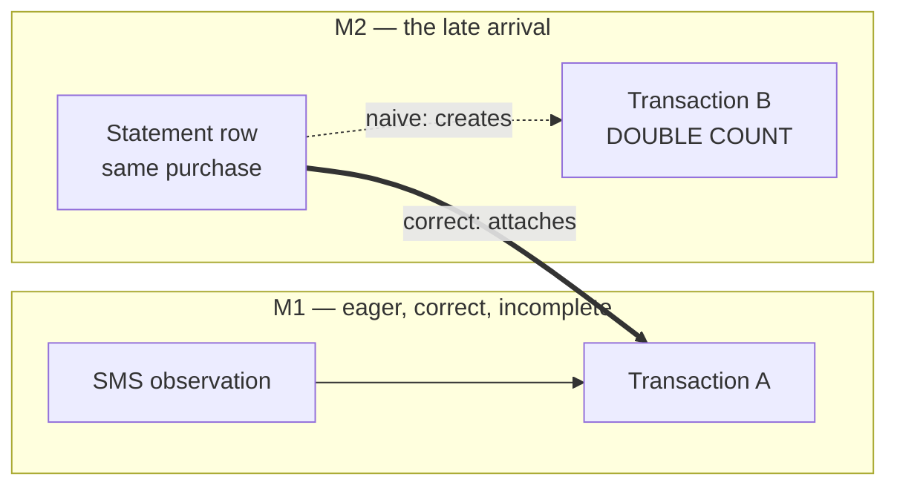

# M2 — Reconciliation

> Status: **implemented.** See [DEVELOPMENT.md](../DEVELOPMENT.md) for what runs and the
> caveats that remain. Two changes were made during implementation: reconciliation lives in
> `modules/ledger` rather than a module of its own, and `suspected_gaps` stores the user's
> decisions rather than the gaps themselves.

## 1. Requirements

### Functional

| #   | Requirement                                                                                       |
| --- | ------------------------------------------------------------------------------------------------- |
| F1  | The same real transaction seen by two sources becomes **one** canonical transaction               |
| F2  | Two genuinely distinct transactions that look identical stay **two** transactions                 |
| F3  | A late-arriving source (statement uploaded weeks later) reconciles against what is already booked |
| F4  | Every canonical transaction can name the observations it was assembled from (invariant I6)        |
| F5  | A balance discontinuity raises a **suspected gap**, never an invented transaction                 |
| F6  | The user can split a wrongly-merged transaction back apart                                        |
| F7  | A user correction survives any later merge                                                        |

### Invariants this must not break

- **The database is the source of truth; the LLM is never the source of truth.** No model
  participates in matching. Matching is deterministic arithmetic and string equality.
- **Financial calculations are deterministic.** Same observation set in, same canonical
  transaction out, on every machine, forever.
- **Never hallucinate financial information.** F5 exists because the tempting version of
  gap detection — creating the missing transaction from the balance delta — fabricates a
  transaction that no source ever reported.

## 2. The problem M1 left behind

M1's admission is **eager**: an observation becomes a transaction the moment its event is
handled ([transaction-admission.service.ts](../../apps/api/src/modules/ledger/application/transaction-admission.service.ts)).
That was right — the product promise is "you spent ₦5,000" seconds after the SMS lands,
and no design that defers admission for a 36-hour matching window can keep it.

But it means reconciliation cannot be a gate placed _before_ admission. By the time a
statement row arrives describing a purchase already known from SMS, **the transaction
already exists**. So M2 is not "match observations then admit" — it is **merge already-admitted
transactions**, which is strictly harder.



The rejected alternative — hold observations in a pending state until a matching window
closes, then admit — buys simpler matching at the cost of the one feature that makes this
product feel alive. Rejected on product grounds, not technical ones.

## 3. Core idea: a transaction is a projection of its observations

The design turns on one decision:

> **A canonical transaction's fields are a pure, deterministic function of the set of
> observations linked to it.**

Nothing is authored directly onto a transaction. `amountMinor`, `occurredAt`,
`description`, `balanceAfterMinor` are all _projected_ from its observation set by a
precedence function. This single choice collapses four hard problems into one:

| Problem               | How the projection solves it                                                                 |
| --------------------- | -------------------------------------------------------------------------------------------- |
| Merging (F1, F3)      | Union the two observation sets, re-project. There is no field-by-field reconciliation logic. |
| Splitting (F6)        | Move an observation to a new transaction, re-project both. Symmetric with merge.             |
| User corrections (F7) | A correction _is_ an observation, `source = USER_STATED`, ranked highest. It cannot be lost. |
| Provenance (F4, I6)   | Automatic — the link table _is_ the derivation.                                              |

Field precedence, highest first: `USER_STATED` → `STATEMENT` → `SMS` / `EMAIL`. Rationale
per field, because it is not uniform:

- **amount, direction, currency** — statements are authoritative (they are the bank's own
  book of record); the user outranks them only because a user disputing an amount is a
  signal we must not silently discard.
- **occurredAt** — SMS wins over statement. An alert is timestamped at the moment of the
  transaction; statement rows are frequently date-only or carry the _booking_ date, which
  can be days later. Using the statement date would move transactions between months.
- **balanceAfterMinor** — whichever observation is latest by `occurredAt`, since it is a
  point-in-time reading, not a property of the transaction.

That `occurredAt` rule is the subtle one, and it is a correctness matter rather than a
nicety: a purchase on 31 August whose statement books on 2 September must stay in August,
or every month-boundary total is wrong.

## 4. Matching: biased toward under-merging, on purpose

The two failure modes are **not** symmetric:

| Failure         | What the user sees                         | Recoverable?                    |
| --------------- | ------------------------------------------ | ------------------------------- |
| **Under-merge** | A duplicate transaction, visibly wrong     | Yes — they can see it and merge |
| **Over-merge**  | Real spending silently missing from totals | **No — invisible**              |

An over-merge makes the ledger quietly understate what the user spent. That is the exact
failure this whole product exists to prevent, and the user has no way to notice it. So
every ambiguous case resolves to _not merging_.

### Candidate criteria — all required

- same `userId`, same `accountId`, same `currency`, same `direction`
- **exact** `amountMinor` equality — never fuzzy. ₦5,000 and ₦5,050 are different
  transactions, and amount tolerance is the fastest route to an over-merge.
- `occurredAt` within a window: **±36h** when either side is a statement (booking skew),
  **±90s** between two alert-sourced observations (the same alert arriving twice by SMS
  and email).

### Veto rules — any one blocks the merge

1. **Reference mismatch.** Both have a non-null `rawReference` and they differ ⇒ different
   transactions, full stop, regardless of every other signal agreeing.
2. **Balance mismatch.** Both report `balanceAfterMinor` and they differ ⇒ not the same
   transaction. (The same transaction cannot leave two different balances behind.)
3. **Ambiguity.** More than one candidate matches ⇒ merge nothing. Two genuine ₦100
   airtime top-ups on one day are indistinguishable, and guessing understates spending.

### Confidence promotion

Matching reference equality is a much stronger signal than amount-and-time coincidence, so
it earns an automatic merge. Everything weaker becomes a **suspected duplicate** the user
is asked about, rather than a silent decision:

| Evidence                                    | Action                    |
| ------------------------------------------- | ------------------------- |
| `rawReference` equal                        | Merge automatically       |
| `balanceAfterMinor` equal + amount + window | Merge automatically       |
| Amount + window only, single candidate      | **Ask the user**          |
| Anything ambiguous or vetoed                | Leave separate, no prompt |

Asking is not a cop-out here. Silently reshaping someone's financial history on
circumstantial evidence is precisely the behaviour that would make a CFO untrustworthy.

## 5. Supersession, not deletion

When A absorbs B, **B is not deleted**. B keeps its row and gains
`supersededByTransactionId = A`. Deleting would break every insight, memory, and past
explanation that cited B's id, and would destroy the audit trail that makes a merge
reviewable.

**The survivor is the earliest-created transaction.** Not the "better sourced" one — id
stability matters more, because ids leak into insights and conversation history that
already quoted them.

### The double-counting hazard, and why a comment is not enough

Superseded rows must be excluded from every aggregate, or **every total silently doubles**.
This is the single most dangerous line of work in M2, and "remember to filter it" is not a
control.

It is made structural instead. [`buildPredicates`](../../apps/api/src/modules/ledger/infrastructure/sql/aggregate-compiler.ts)
is a genuine choke point — both the aggregate and list queries build their `WHERE` from it,
and it already carries a mandatory base predicate set including `status`. The exclusion
joins that mandatory set, so it cannot be omitted by a query that forgets it; there is no
code path that assembles predicates any other way.

Backed by a guard test in the established style of `managed-indexes`: enumerate every
query the compiler can emit and assert each contains the supersession predicate. A future
query that skips it fails the build rather than under-reporting someone's spending.

## 6. Gap detection needs no scheduler

ADR-007 committed to Temporal on day one, and the reflex is to make reconciliation a
scheduled Temporal workflow. That reflex is wrong here, and worth resisting:

- **The reactive path needs no scheduler.** A new observation matching an existing
  transaction is an indexed candidate lookup, cheap enough to run inside the admission
  transaction that already exists.
- **The late-arrival path is user-triggered.** Statement rows arrive because a human
  uploaded a statement. Reconciliation runs when that import completes — an event, not a
  clock.
- **Gap detection is a query, not a job.** Given transactions ordered by `occurredAt` with
  known `balanceAfterMinor`, a gap is arithmetic: where
  `balanceAfter[n] ≠ balanceAfter[n-1] ± amount[n]`, activity is missing, and the
  discrepancy is its size. Nothing needs to be written for this to be true, so it can be
  computed when asked.

So **M2 ships without Temporal**, and Temporal stays scoped to the outbox relay and
statement parsing, where durability across process death genuinely matters. This keeps a
substantial dependency out of the critical path without creating debt: no polling loop, no
`setInterval`, nothing to rip out later.

### Why gaps stay suspicions

Balance arithmetic is weaker evidence than it looks:

- "Available balance" and "ledger balance" differ when holds exist, and sources disagree
  about which they report.
- Interleaved transactions within the same second have no reliable order.
- A single missing balance reading breaks the chain without meaning anything is missing.

So a gap is reported as a **question** — "there may be about ₦12,000 of activity around
3 August I don't know about" — and never as a transaction. Detection requires an unbroken
same-account, same-currency chain of readings; any break narrows the claim instead of
widening it.

## 7. Risks

| ID  | Risk                                                                      | Severity | Mitigation                                                                    |
| --- | ------------------------------------------------------------------------- | -------- | ----------------------------------------------------------------------------- |
| R9  | **Over-merge silently understates spending** — invisible to the user      | Critical | Exact amounts; reference and balance vetoes; ambiguity refuses; merge audit   |
| R10 | **A query path forgets the supersession filter** — every total doubles    | Critical | Mandatory predicate in the single choke point + enumerating guard test        |
| R11 | Gap false positives erode trust ("you're missing transactions" — wrong)   | High     | Conservative chains, phrased as a question, never auto-created                |
| R12 | Statement date-only granularity widens windows, increasing ambiguity      | Medium   | ±36h only when a statement is involved; ambiguity refuses rather than guesses |
| R13 | Merging a transaction already cited by an insight leaves a dangling story | Medium   | Supersession keeps the old id resolvable; insights follow the survivor        |
| R14 | Re-projection changes a number the user already saw and remembers         | Medium   | Merge audit records before/after; a changed total is explainable, not silent  |

R9 and R10 are the two that can make Atlas lie about money. Both are addressed
structurally rather than by diligence.

## 8. Folder structure

```
modules/reconciliation/
  domain/
    match-candidate.ts          # candidate criteria, windows, veto rules — pure
    match-decision.ts           # MERGE | ASK | SEPARATE, with the evidence that decided it
    transaction-projection.ts   # observation set -> canonical field values (pure)
    balance-chain.ts            # gap detection over ordered balance readings (pure)
    reconciliation.port.ts      # repository interface owned by the domain
  application/
    reconcile-observation.service.ts   # reactive path, runs within admission
    reconcile-import.service.ts        # late-arrival path, on import completion
    merge-transactions.service.ts      # supersession + re-projection, transactional
    split-transaction.service.ts       # F6, the inverse
    suspected-duplicate.service.ts     # queue the ASK decisions
  infrastructure/
    prisma-reconciliation.repository.ts
  api/
    reconciliation.controller.ts       # confirm/reject a suspected duplicate; split
```

`domain/` is pure and has no Prisma import, so the matching rules and the projection are
unit-testable without a database — which is what makes exhaustive table-driven tests of
the veto matrix affordable.

## 9. Interfaces (shape only)

```ts
type MatchDecision =
  | { kind: 'merge'; into: TransactionId; evidence: MatchEvidence }
  | { kind: 'ask'; candidate: TransactionId; evidence: MatchEvidence }
  | { kind: 'separate'; reason: SeparationReason };

// Why, always — a merge that cannot explain itself is not reviewable.
interface MatchEvidence {
  readonly referenceEqual: boolean;
  readonly balanceEqual: boolean;
  readonly secondsApart: number;
  readonly candidateCount: number;
}

type SeparationReason =
  'no-candidate' | 'reference-mismatch' | 'balance-mismatch' | 'ambiguous-candidates';

// Pure. The whole ledger's truthfulness rests on this being a function.
function projectTransaction(observations: readonly ObservationFacts[]): CanonicalFields;

function decideMatch(
  incoming: ObservationFacts,
  candidates: readonly CandidateTransaction[],
): MatchDecision;

function detectGaps(readings: readonly BalanceReading[]): readonly SuspectedGap[];
```

## 10. Schema delta

Four additions, no destructive changes:

```prisma
model Transaction {
  // Set when this transaction was absorbed by another. Never deleted: insights,
  // memories and past explanations may already cite this id.
  supersededByTransactionId String?
  supersededBy   Transaction?  @relation("Supersession", fields: [supersededByTransactionId], references: [id])
  supersedes     Transaction[] @relation("Supersession")

  @@index([userId, supersededByTransactionId])   // the exclusion predicate's index
}

/// A merge or split that happened, and the evidence that justified it. Append-only.
model ReconciliationEvent {
  id                String   @id
  userId            String
  kind              ReconciliationKind   // MERGE | SPLIT | GAP_FLAGGED
  survivingTransactionId String?
  absorbedTransactionId  String?
  evidence          Json                  // MatchEvidence, for review
  decidedBy         ReconciliationActor   // SYSTEM | USER
  createdAt         DateTime @default(now()) @db.Timestamptz(3)
}

/// An ASK decision awaiting the user. Not a transaction — a question about two.
model SuspectedDuplicate {
  id        String  @id
  userId    String
  leftTransactionId  String
  rightTransactionId String
  evidence  Json
  resolution SuspectedDuplicateResolution?  // MERGED | KEPT_SEPARATE | null
  @@unique([userId, leftTransactionId, rightTransactionId])
}

/// Balance discontinuity. A question, never a transaction.
model SuspectedGap {
  id          String  @id
  userId      String
  accountId   String
  currency    String
  amountMinor BigInt          // size of the discrepancy
  afterAt     DateTime @db.Timestamptz(3)
  beforeAt    DateTime @db.Timestamptz(3)
  resolution  SuspectedGapResolution?
}
```

`ReconciliationEvent` is append-only and exists so that when a total changes under the
user, we can say exactly why (R14). It is not optional bookkeeping — it is what makes a
merge defensible after the fact.

All four tables need RLS policies appended to the migration, and `managed-indexes.sql`
must be re-appended, or Prisma drops the HNSW and trigram indexes again.

## 11. Test plan

| Layer                | What it proves                                                                     |
| -------------------- | ---------------------------------------------------------------------------------- |
| `projectTransaction` | Precedence per field; `occurredAt` prefers SMS over statement; determinism         |
| `decideMatch`        | Full veto matrix, table-driven; ambiguity refuses; identical same-day pair stays 2 |
| `detectGaps`         | Discontinuity found; broken chain narrows rather than widens; holds don't fire     |
| Merge service        | Union + re-project; survivor is earliest; user correction survives (F7)            |
| Split service        | Exact inverse of merge — round-trip restores both projections                      |
| **Compiler guard**   | **Every emitted query excludes superseded rows** (R10)                             |
| Integration          | SMS then statement for one purchase ⇒ one transaction, two observations, one total |
| Integration          | Two genuine identical ₦100 top-ups ⇒ two transactions, correct total (F2)          |

The two integration tests are the ones that matter: the first is F1 end to end, the second
is the over-merge that would silently steal money from the user's own history.
